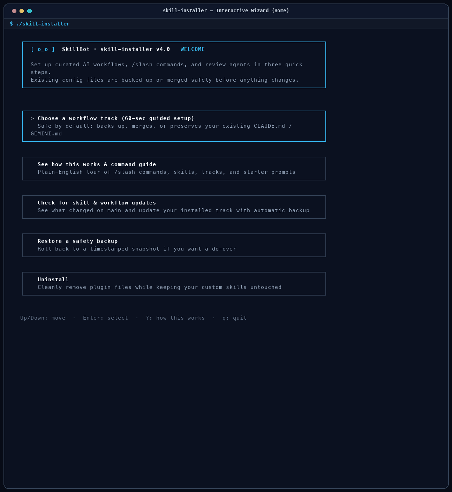
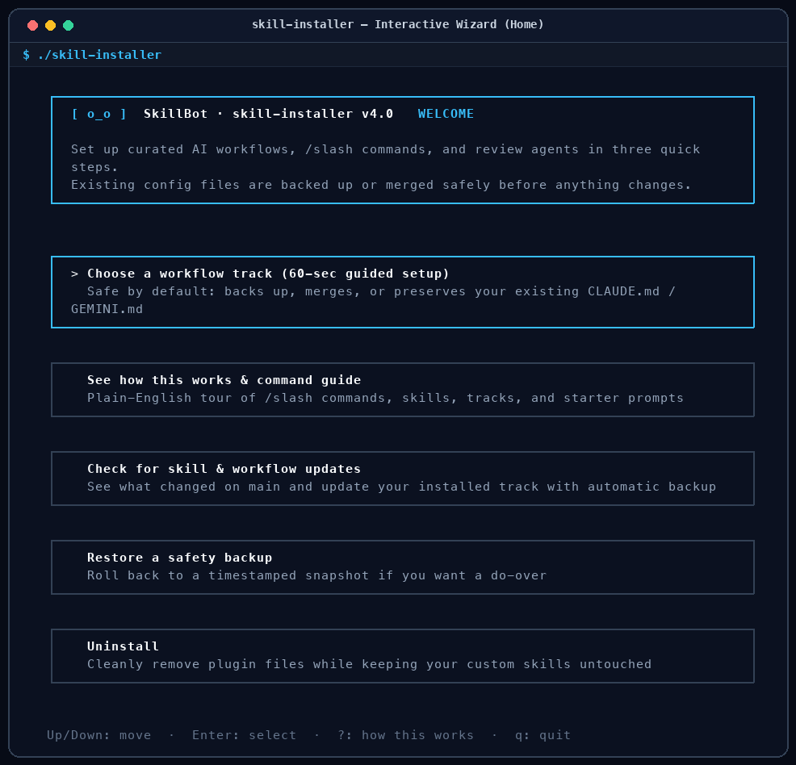
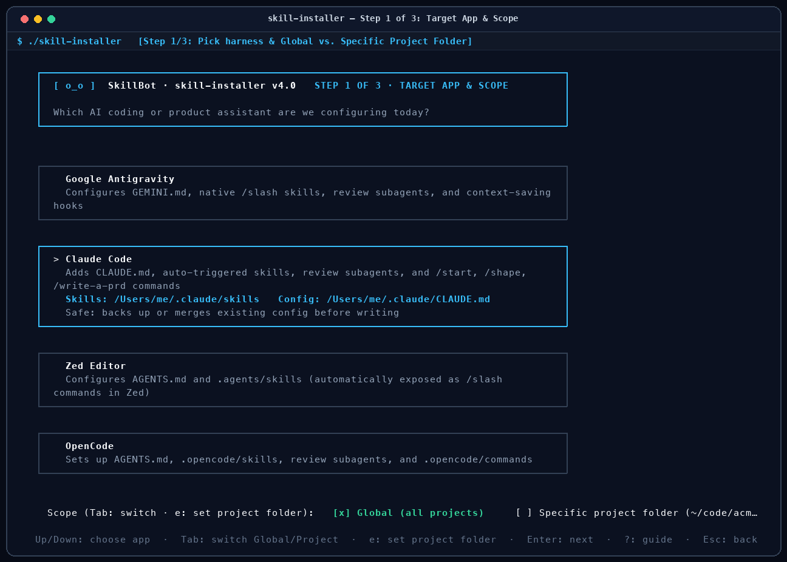
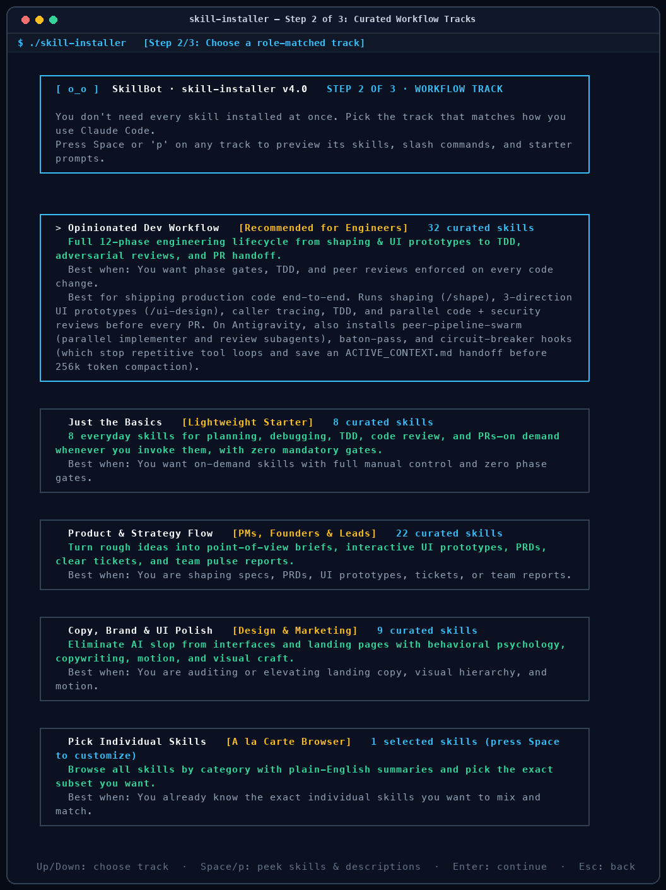
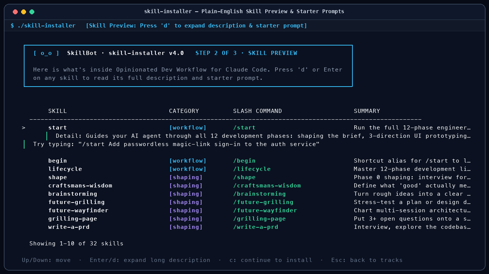
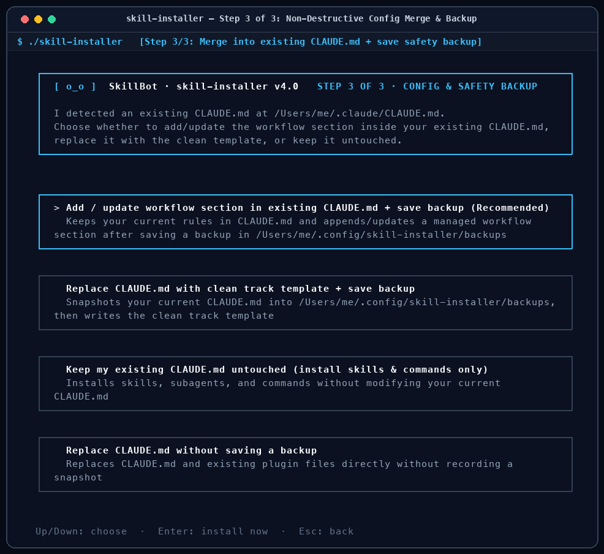
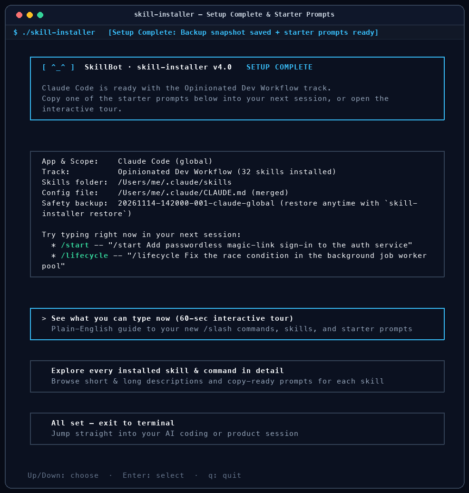
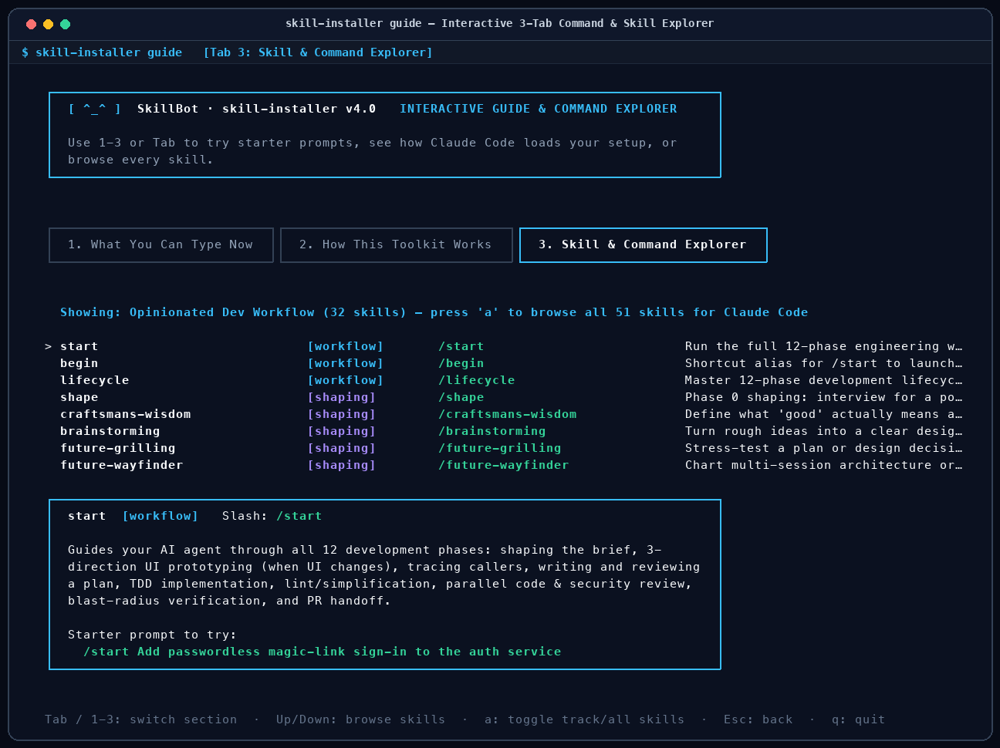

# `skill-installer` (v4.0)

[](https://github.com/futuregerald/futuregerald-claude-plugin/actions/workflows/test.yaml)
[](https://github.com/futuregerald/futuregerald-claude-plugin/releases/latest)
[](LICENSE)

**Set up a complete, role-matched AI workflow across Claude Code, Claude Desktop, Google Antigravity, Zed, and OpenCode in 60 seconds—without bloating your context window or overwriting your existing rules.**

`skill-installer` is a cross-platform (macOS, Linux, Windows) interactive terminal wizard and CLI that installs **curated tracks** of AI skills, `/slash` commands, adversarial review subagents, and harness rules—preserving your custom `CLAUDE.md`, `GEMINI.md`, or `AGENTS.md` and saving a timestamped rollback snapshot before touching a single file.

<p align="center">
  
  <br>
  <sub>Interactive 3-step TUI wizard &amp; command explorer (<a href="docs/assets/tui-walkthrough.mp4">watch MP4 video</a>)</sub>
</p>

---

## Why `skill-installer`?

Dumping 50+ skills into your AI agent all at once backfires: every loaded skill competes for your model's context window and attention, and manual repo scripts often clobber your carefully tuned `CLAUDE.md` or `GEMINI.md`.

| Without `skill-installer` | With `skill-installer` |
|---|---|
| **Context bloat:** Loading 50+ skills at once crowds out code context and degrades instruction-following | **Role-matched tracks:** Pick a curated track (`8` to `35` skills) built for how you actually work |
| **Fragile manual setup:** Copying files between `~/.claude/`, `~/.gemini/`, `.agents/`, and `.opencode/` by hand | **One 60-second wizard:** Installs the right layout for **Claude Code**, **Claude Desktop**, **Antigravity**, **Zed**, or **OpenCode** |
| **Clobbered config files:** Template scripts overwrite your personal or repo `CLAUDE.md` / `GEMINI.md` | **Non-destructive merge + 1-command rollback:** Updates a delimited section inside your existing config after saving a backup |
| **"Wait, what did that install?":** Digging through Markdown files to remember command names | **Built-in interactive guide (`skill-installer guide`):** Browse every skill, `/slash` command, and copy-ready starter prompt in your terminal |

---

## Quick Start (60 Seconds)

Download the prebuilt binary for your OS from the [**Latest GitHub Release**](https://github.com/futuregerald/futuregerald-claude-plugin/releases/latest) and run it with no flags to launch the interactive wizard:

### macOS & Linux

```bash
# Download the archive for your OS/CPU from Releases, extract, and launch:
tar -xzf skill-installer_<version>_<os>_<arch>.tar.gz
./skill-installer
```

> **macOS Gatekeeper note:** If macOS blocks an unsigned binary downloaded in a browser, clear the quarantine attribute once before running:
> ```bash
> xattr -d com.apple.quarantine ./skill-installer
> ```

### Windows (PowerShell)

```powershell
Expand-Archive skill-installer_<version>_windows_amd64.zip -DestinationPath .
.\skill-installer.exe
```

### Build from Source (Go 1.24+)

```bash
git clone https://github.com/futuregerald/futuregerald-claude-plugin.git
cd futuregerald-claude-plugin
go build -o skill-installer .
./skill-installer
```

---

## Which Track Fits Your Role?

Every loaded skill competes for your AI agent's context window. Instead of installing everything, pick the track designed for your day-to-day work (or cherry-pick individual skills):

| Track | Best For | Skills Installed | Key `/slash` Commands & Capabilities | Starter Prompt to Try Immediately |
|---|---|---|---|---|
| **Opinionated Dev Workflow** (`--track=opinionated`) | Software engineers shipping production code with high rigor | **32** (Claude / Zed / OpenCode)<br>**35** (Antigravity) | `/start`, `/begin`, `/lifecycle`, `/shape`, `/ui-design`, `/plan-review`, `/fix-check`, `/copy-edit` — full 12-phase lifecycle with 3-direction HTML UI prototyping, caller tracing, TDD, parallel code & security review, and blast-radius verification | `"/start Add passwordless magic-link sign-in to the auth service"` |
| **Just the Basics** (`--track=basics`) | Developers who want everyday tools without strict phase gates or hooks | **8** | `/brainstorming`, `/writing-plans`, `/systematic-debugging`, `/test-driven-development`, `/comprehensive-code-review`, `/pull-request-description`, `/handoff`, `/plugin-update` | `"/brainstorming Let's design a webhook retry queue with exponential backoff"` |
| **Product & Strategy Flow** (`--track=product`) | PMs, designers, founders, and engineering managers | **22** | `/shape`, `/craftsmans-wisdom`, `/future-grilling`, `/future-wayfinder`, `/grilling-page`, `/write-a-prd`, `/writing-tickets`, `/ticket-grooming`, `/ui-design`, `/visualize-plan`, `/copy-edit`, `/editor-pass`, `/meeting-debrief`, `/team-pulse` | `"/shape We want to redesign customer onboarding so teams activate in under 5 minutes"` |
| **Copy, Brand & UI Polish** (`--track=copy-polish`) | Auditing and elevating landing pages, product UI, copy, and motion | **9** | `/copy-edit`, `/copywriting`, `/marketing-psychology`, `/editor-pass`, `/impeccable`, `/no-slop-ui`, `/huashu-design`, `/animation-principles`, `/plugin-update` | `"/copy-edit Audit our pricing page for clarity, conversion friction, and visual hierarchy"` |
| **Pick Individual Skills** (`--track=custom`) | Power users building a custom à la carte toolkit | **Any subset of 48** (Claude / Zed / OpenCode)<br>**or 51** (Antigravity) | Interactive skill browser with `[x]` multi-select, category badges, and plain-English descriptions | Any starter prompt from your chosen skills |

---

## Interactive Guided Tour (What Happens When You Run `./skill-installer`)

Running `./skill-installer` with no arguments opens the **SkillBot** terminal UI:

### Home Screen — Install, Explore, Update, Restore, or Uninstall

Choose a 60-second guided setup, open the interactive command guide, pull updates from `main`, restore a timestamped backup, or cleanly uninstall.

<p align="center">
  
</p>

### Step 1 of 3 — Pick Your AI App & Scope (Global vs. Project Folder)

Select **Claude Code** (CLI & Claude Desktop), **Google Antigravity** (Desktop IDE), **Zed Editor**, or **OpenCode**, then choose whether to install **Globally** (`~`) or into a **Specific Project Folder** (e.g., `~/code/acme-api`) so you can trial a track in one repo without touching your global setup.

<p align="center">
  
</p>

### Step 2 of 3 — Choose a Curated Workflow Track & Preview Every Skill

Compare the 5 tracks with plain-English summaries, skill counts, and a recommendation badge. Press **`p`** on any track to inspect every included skill, or press **`d`** / **`Enter`** on a skill to expand its full description and copy-ready starter prompt before installing.

<p align="center">
  
</p>

<p align="center">
  
</p>

### Step 3 of 3 — Non-Destructive Config Merge & Automatic Safety Backup

If `skill-installer` detects an existing `CLAUDE.md`, `GEMINI.md`, or `AGENTS.md`, it **never** blindly overwrites your file. You choose how to handle it:

1. **Add / update workflow section in existing config + save backup (Recommended)** — Keeps every line of your existing rules intact and appends/updates a managed block (`<!-- BEGIN SKILL-INSTALLER WORKFLOW RULES -->` … `<!-- END SKILL-INSTALLER WORKFLOW RULES -->`) after saving a full backup snapshot.
2. **Replace config with clean track template + save backup** — Snapshots your existing file first, then writes the clean track template.
3. **Keep my existing config untouched** — Installs skills, subagents, and `/slash` commands without modifying your `CLAUDE.md` / `GEMINI.md` / `AGENTS.md`.
4. **Replace without saving a backup** — Overwrites directly.

<p align="center">
  
</p>

### Setup Complete — Immediate Starter Prompts & Backup Receipt

Every run finishes with exact file paths, your rollback snapshot ID, and **copy-ready starter prompts** tailored to your installed track so you can paste one directly into your next AI session.

<p align="center">
  
</p>

---

## Interactive 3-Tab Command & Skill Guide (`skill-installer guide`)

Run `skill-installer guide` at any time (or open it directly from the **Setup Complete** screen) for an interactive terminal tour of your installed toolkit:

- **Tab 1 (`1. What You Can Type Now`):** Plain-English breakdown of `/slash` commands vs. auto-loaded skills for your specific harness, plus copy-ready prompts.
- **Tab 2 (`2. How This Toolkit Works`):** Explains why curated tracks protect your context window, how skills vs. subagents vs. rules fit together, and how rollback backups work.
- **Tab 3 (`3. Skill & Command Explorer`):** Searchable browser of your track's skills (press **`a`** to toggle between your installed track and all 51 catalog skills) with category badges, `/slash` triggers, full descriptions, and starter prompts.

<p align="center">
  
</p>

```bash
# Open the interactive 3-tab guide
skill-installer guide

# Print a plain-text summary for scripts or non-TTY terminals
skill-installer guide --target=claude --track=opinionated --yes
```

---

## Supported Harnesses (Desktop Apps & CLIs)

`skill-installer` adapts every skill, subagent, `/slash` command, and rule file to each harness's native directory structure—and coexists cleanly with your existing desktop app settings and MCP servers:

| Harness | CLI & Desktop Coverage | Global Install Paths | Project Install Paths | Coexistence Guarantees |
|---|---|---|---|---|
| **Claude Code & Claude Desktop** (`--target=claude`) | `claude` CLI + **Claude Desktop** (`Claude.app` Code / Cowork tab) | `~/.claude/CLAUDE.md`<br>`~/.claude/skills/`<br>`~/.claude/agents/`<br>`~/.claude/commands/` | `<project>/CLAUDE.md`<br>`<project>/.claude/skills/`<br>`<project>/.claude/agents/`<br>`<project>/.claude/commands/` | Preserves `claude_desktop_config.json` (MCP servers & desktop preferences) untouched |
| **Google Antigravity** (`--target=antigravity`) | **Antigravity Desktop IDE** (`Antigravity.app`) + `agy` CLI | `~/.gemini/GEMINI.md`<br>`~/.gemini/config/skills/`<br>`~/.gemini/config/plugins/antigravity-subagents/`<br>`~/.gemini/config/hooks/` & `~/.gemini/config/hooks.json` *(Opinionated track)*<br>`~/.gemini/config/rules/org.example.md` | `<project>/GEMINI.md`<br>`<project>/.agents/skills/`<br>`<project>/.agents/agents/` | Preserves `~/.gemini/antigravity/mcp_config.json` and merges co-tenant `PreToolUse` entries in `~/.gemini/config/hooks.json` without dropping third-party hooks |
| **Zed Editor** (`--target=zed`) | **Zed Desktop** (`Zed.app` / `zed` CLI) | `~/.config/zed/AGENTS.md` *(macOS/Linux)*<br>`%APPDATA%\Zed\AGENTS.md` *(Windows)*<br>`~/.agents/skills/` | `<project>/AGENTS.md`<br>`<project>/.agents/skills/` | Preserves `~/.config/zed/settings.json` and `keymap.json`; skills surface automatically as native `/<skill-name>` slash commands |
| **OpenCode** (`--target=opencode`) | `opencode` CLI & TUI | `~/.config/opencode/AGENTS.md`<br>`~/.config/opencode/skills/`<br>`~/.config/opencode/agents/`<br>`~/.config/opencode/commands/` | `<project>/AGENTS.md`<br>`<project>/.opencode/skills/`<br>`<project>/.opencode/agents/`<br>`<project>/.opencode/commands/` | Preserves `~/.config/opencode/opencode.json` model and provider config untouched |

---

## Non-Interactive CLI Reference (Scripting & CI)

Every action in the interactive wizard is also available via flags for dotfiles, onboarding scripts, and headless environments:

```bash
# Install the Opinionated Dev Workflow globally for Claude Code + Claude Desktop
skill-installer --target=claude --global --track=opinionated --backup=true --yes

# Non-destructively merge the workflow block into an existing CLAUDE.md / GEMINI.md / AGENTS.md
skill-installer --target=claude --global --track=opinionated --merge-config --backup=true --yes

# Install the Product & Strategy track into a single project repository
skill-installer --target=claude --project=/path/to/repo --track=product --yes

# Install a custom subset of skills for Zed Editor
skill-installer --target=zed --global --track=custom \
  --skills=brainstorming,writing-plans,test-driven-development,comprehensive-code-review --yes

# List all tracks and catalog skills (or filter by --target / --track)
skill-installer list --target=claude

# Check for and apply upstream skill updates from main (saves a backup first)
skill-installer update --apply --yes

# Restore the latest safety backup (or pass --id=<backup-id>)
skill-installer restore --yes

# Uninstall plugin-managed files while keeping your custom skills untouched
skill-installer uninstall --target=claude --global --yes
```

---

## Updating, Restoring Backups & Uninstalling

### Updating Installed Skills (`skill-installer update` or `/plugin-update`)

- **From your AI chat session:** Type `/plugin-update` in Claude Code, Antigravity, Zed, or OpenCode.
- **From your terminal:** Run `skill-installer update` (or choose **Check for skill & workflow updates** on the home screen). It fetches the latest `main` archive from `futuregerald/futuregerald-claude-plugin`, snapshots your current install, and refreshes your installed track.

### Restoring a Backup (`skill-installer restore`)

Every backup snapshot is stored under `~/.config/skill-installer/backups/<timestamp>-<seq>-<harness>-<scope>/` (or `%APPDATA%\skill-installer\backups\` on Windows) with a complete manifest of pre-existing and newly created files. Running `skill-installer restore` restores modified files and removes newly added ones in one step.

### Uninstalling (`skill-installer uninstall`)

Each installation writes a receipt tracking only the files managed by `skill-installer`. Running `skill-installer uninstall` removes those managed files (or strips only the `<!-- BEGIN SKILL-INSTALLER WORKFLOW RULES -->` block if you merged into an existing `CLAUDE.md` / `GEMINI.md` / `AGENTS.md`), leaving your own custom skills and rules untouched.

---

## Development & Verification Gates

### Fast Unit & Catalog Closure Tests

```bash
test -z "$(gofmt -l .)"
go vet ./...
HOME=$(mktemp -d) go test -race ./...
PYTHONDONTWRITEBYTECODE=1 pytest -p no:cacheprovider -q \
  internal/catalog/shared/skills/editor-pass/scripts \
  internal/catalog/shared/skills/future-skill-creator/scripts \
  internal/catalog/shared/skills/grilling-page/scripts \
  internal/catalog/shared/skills/team-pulse/scripts \
  internal/catalog/shared/skills/visualize-plan/scripts \
  internal/catalog/antigravity/hooks
```

### Real Multi-Harness Docker & PTY E2E Suite (`make test-e2e`)

To verify `skill-installer` against real installed CLI & desktop harnesses (`claude`, `Claude.app`, `Antigravity.app`, `Zed.app`, `opencode`), live `PreToolUse` circuit-breaker hook execution, and real pseudo-terminal (`PTY`) Bubble Tea keystroke journeys inside an isolated Linux container:

```bash
make test-e2e
```
