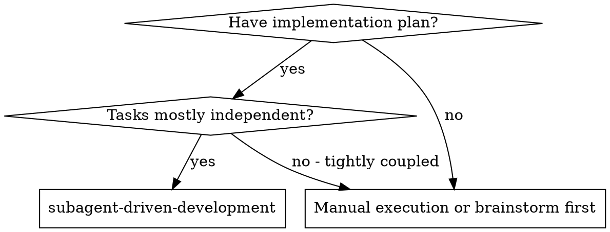
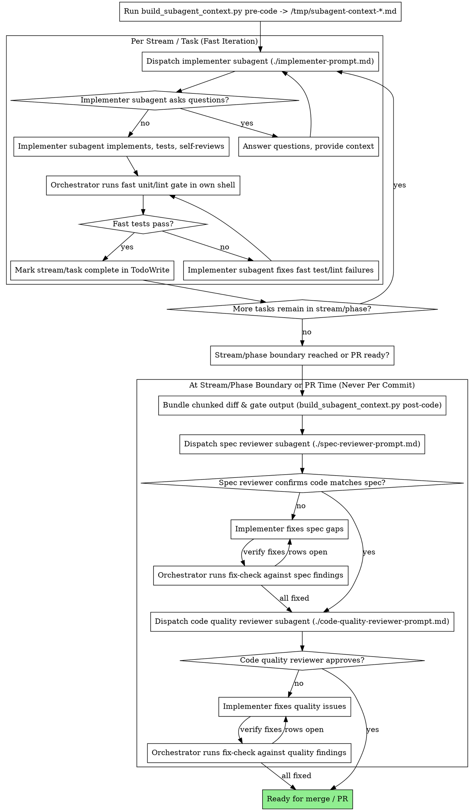

# Subagent-Driven Development

Execute plan by dispatching fresh subagents per cohesive stream. Per-stream/task verification runs the implementer's fast unit tests plus the orchestrator's fast unit/lint gate; read-only Adversarial Reviewers (`spec-reviewer` then `code-quality-reviewer`, or `comprehensive-code-review`) run once per stream/phase boundary or at PR time against `/tmp/subagent-context-<project>-<stream>.md` (never per commit).

**Core principle:** Fresh subagent per stream + pre-packed context bundle + batched reads/edits + fast unit verification + read-only review at stream/phase boundaries = high quality, fast iteration without token exhaustion.

## Execution Roles & Harness-Native Dispatch

Shared skills name **abstract roles** (`Lead / Planner`, `Implementer`, `Adversarial Reviewer`, `Retriever`). The active harness's root configuration (`CLAUDE.md` in Claude Code, or the harness's global root instructions elsewhere) owns the concrete model and sub-agent tool mapping:

| Abstract Role | Default Mapping (`CLAUDE.md`) | Purpose & Constraints |
|---|---|---|
| **Lead / Planner** | Opus 5.5 (`model: "opus"`), Effort: `medium` (`high` for net-new multi-layer architecture/migrations) | Coordinates, runs initial triage (`git grep -n`, ≤3 inline calls) to identify the entry-point `file:line` first, checks repo lint/wording scripts (`package.json`, `Makefile`, `scripts/check-*.mjs`) and exact shared contract definitions before freezing `PLAN.md`, builds `/tmp/subagent-context-<project>-<stream>.md` via `build_subagent_context.py pre-code` (never putting unverified hypotheses under `## Known Facts`; use `## Hypotheses to Falsify`), runs `build_subagent_context.py post-code` after fast gates pass, deletes temp file after review approval, commits. Implements inline on quick (<5-turn, ≤2-file) single-stream tasks to avoid subagent handoff loss; delegates multi-turn/multi-file streams. Never halts prematurely between streams. |
| **Implementer Subagent** | Sonnet 5.5 (`model: "sonnet"`, `subagent_type: "implementer"`), Effort: `medium` (escalate to `opus` on security/concurrency/error-taxonomy streams) | Fresh context per cohesive stream. Reads `/tmp/subagent-context-<project>-<stream>.md` and `<plan_path>` on Turn 1, batches remaining file reads (`5–12` files/turn, `400–800` lines/read, zero 1-file tail loops), batches edits across distinct files (`4–8` files/turn) while keeping same-file edits to 1 contiguous replacement (or full file write when `<300` lines), follows TDD using **fast unit tests only** (never E2E or `pretest` builds), writes zero comments, never uses `node -e` / `python3 -c` regex source edits, and returns the **5-section handoff**. If a CLI/test runner fails twice, reads `vitest.config.*`/`tsconfig.json`/`Makefile` immediately instead of guessing flags. Never use Haiku. |
| **Adversarial Reviewer** *(Plan, Spec, Security, Code Quality, SQL)* | Opus 5.5 (`model: "opus"`, `subagent_type: "adversarial-plan-reviewer"` / `"spec-reviewer"` / `"code-quality-reviewer"` / `"security-reviewer"` / `"sql-reviewer"`), Effort: `high` | **Strictly read-only.** Runs at plan gate (Phase 3½) and stream/phase boundary or PR time (never per commit). Reads all indexed `StartLine-EndLine` chunks of `/tmp/subagent-context-<project>-<stream>.md` in parallel on Turn 1, then batches follow-up caller/contract reads (`5–10` files/turn, `400–800` lines/read). Never executes tests, builds, or E2E suites. |

### Deterministic Context Bundler (`build_subagent_context.py`), Turn Batching & Fast-Test Rules

To eliminate duplicate file reads, redundant searches, micro-slice tail loops, and $O(N^2)$ token re-billing across subagents:
1. **Build Pre-Code Context Bundle (`pre-code`):** After initial triage (`git grep -n`, ≤3 inline calls) and plan approval, pack exact target slices (`file:start-end`), extracted `## Acceptance Criteria`, and fast gate commands into `/tmp/subagent-context-<project>-<stream>.md`:
   ```bash
   python3 ~/.claude/skills/subagent-driven-development/scripts/build_subagent_context.py pre-code \
     --output /tmp/subagent-context-<project>-<stream>.md \
     --plan <plan_path> \
     --slice <file:start-end> \
     --gate-cmd "<fast_gate_cmd>"
   ```
   Append any extra verified `file:line` facts under `## Known Facts` (never unverified guesses; put unproven ideas under `## Hypotheses to Falsify`).
2. **Turn-1 Parallel Context Read & Turn Batching Rules (Mandatory for All Subagents):**
   - **Turn 1:** Read `/tmp/subagent-context-<project>-<stream>.md` (when `>750` lines, issue parallel `Read` calls across every `StartLine-EndLine` window listed in `## Read Chunk Index`) and `<plan_path>` on Turn 1. Never re-search or re-read unchanged slices already embedded in the context bundle.
   - **Parallel File Reads:** Batch additional file reads (`5–12` files per turn, `400–800` lines per read). Never read files in `30–50` line micro-slices or serial 1-file tail loops.
   - **Distinct-File vs. Single-File Edit Batching:** Batch edits across **distinct files** in parallel (`4–8` files/turn). On a **single file**, prefer 1 contiguous `Edit` replacement (or a full `Write` when `<300` lines) — never issue `3+` separate `Edit` calls against the same file in a single turn.
   - **Ban Ad-Hoc Regex Source Mutations:** Never mutate source or test files with inline `node -e` or `python3 -c` regex scripts; use structured `Edit`/`Write` calls or deterministic, tested repo scripts.
   - **Single Combined Fast Gate:** Run 1 combined fast unit + typecheck/lint gate command at the end of the task rather than re-running full suites after every file edit.
3. **Fast Local Tests Only (No Local E2E, No `pretest` Builds):**
   - Implementers and orchestrators run **only fast unit tests and typecheck/lint** (`npx vitest run <spec>`, `npm run typecheck`, `go test ./pkg/...`, `bundle exec rspec <spec>`). Never run `pretest` multi-bundle builds on unit test runs.
   - **Never run E2E suites (`playwright test`, `npm run e2e`) or full-repo sweeps locally between fixes, changes, or streams.** While E2E and full-repo sweeps are never run as per-turn iteration gates, before opening or merging a PR the agent must check `.github/workflows/` PR triggers (`pull_request`); if a suite (`e2e`, `govulncheck`, `models`) is gated off on PRs (`if: github.event_name != 'pull_request'`), run the targeted check locally or update/trigger the workflow before merging to `main`.
4. **Bundle Chunked Diff & Gate Output Before Review (`post-code`):** Once fast gates pass, append the passing gate summary and chunked `git diff -U3` (with two-pass `## Read Chunk Index` `StartLine-EndLine` offsets) to `/tmp/subagent-context-<project>-<stream>.md`:
   ```bash
   python3 ~/.claude/skills/subagent-driven-development/scripts/build_subagent_context.py post-code \
     --output /tmp/subagent-context-<project>-<stream>.md \
     --base <base_sha_or_ref> \
     [--head <head_sha>] \
     --gate-log /tmp/gate.log
   ```
   Omit `--head` when changes are uncommitted in the working tree (`git diff -U3 <base>`); pass `--head <sha>` when reviewing committed branch changes (`git diff -U3 <base>...<head>`). Read-only Adversarial Reviewers inspect that file once per stream/phase boundary or PR time (never per commit) and **never** run tests, builds, or E2E suites.
5. **Mandatory 5-Section Implementer Handoff:** Every implementer subagent returns:
   1. `Changes Made`
   2. `Acceptance Criteria & Success Metrics Met` *(table mapping each `AC-N` from the plan to its wired `file:line` runtime entry point and covering test)*
   3. `Flawed Assumptions Surfaced`
   4. `Carried Risks & Edge Cases`
   5. `Verification Evidence`
6. **Targeted Single-Reviewer Re-Verification & Cleanup:** If one reviewer returns `APPROVED` and the other requests localized changes, verify the fix with `fix-check` (findings list + fix diff + gate output), never a fresh reviewer. Once the stream is `APPROVED`, **delete the temp file** (`rm -f /tmp/subagent-context-<project>-<stream>.md`).
7. **Defensive Coding Invariants for Implementers (Mandatory):**
   - **Error classification precedence:** Check specific structural error classes (`DOMException.name`, `SyntaxError`, `TypeError`, explicit numeric `.status`/`.statusCode`) *before* generic message substring regexes so numbers inside quota/syntax messages (e.g. `5000KB`, `position 500`) never match HTTP `500` patterns.
   - **Enforced `Promise.race` timeouts:** Never rely solely on `controller.abort()` inside `setTimeout` when wrapping an external callback (`fetchFn`, `pushFn`); always wrap with `Promise.race` so a callback that ignores `AbortSignal` still rejects on timeout and clears its timer in `finally`.
   - **Nested `Error.cause` traversal:** When formatting or sanitizing errors for logs or trouble reports, walk `.cause` chains with a cycle-safe depth cap and redact every level.
   - **URL sanitization:** Always strip `parsed.search` and `parsed.hash` when producing a redacted or display URL unless query keys are explicitly allowlisted.

### Dispatch Syntax

```typescript
Agent({
  subagent_type: "implementer",
  model: "sonnet",
  description: "Implement task stream",
  prompt: "Read /tmp/subagent-context-<project>-<stream>.md and <plan_path> on Turn 1..."
})
```

*(Non-Claude harnesses route the **Implementer** and **Adversarial Reviewer** roles via their own root configuration.)*

**PRECONDITION — the plan must contain Acceptance Criteria & an Impact Analysis.** The per-task spec and quality reviews below review *code against the plan*, so a wrong plan propagates into every task dispatched from it. Read the plan before dispatching the first implementer, and raise anything that looks wrong with your human partner rather than building on it.

## When to Use



## The Process



## Prompt Templates

- `./implementer-prompt.md` - Dispatch implementer subagent
- `./spec-reviewer-prompt.md` - Dispatch spec compliance reviewer subagent
- `./code-quality-reviewer-prompt.md` - Dispatch code quality reviewer subagent

## Example Workflow

```
You: I'm using Subagent-Driven Development to execute this plan.

[Read plan file once: docs/plans/feature-plan.md]
[Run build_subagent_context.py pre-code --output /tmp/subagent-context-project-stream.md --plan docs/plans/feature-plan.md --slice ...]
[Create TodoWrite with all tasks]

Task 1: Hook installation script

[Dispatch fresh implementation subagent pointing at /tmp/subagent-context-project-stream.md + docs/plans/feature-plan.md]

Implementer: "Before I begin - should the hook be installed at user or system level?"

You: "User level (~/.config/superpowers/hooks/)"

Implementer: "Got it. Implementing now..."
[Later] Implementer:
  - Implemented install-hook command
  - Added fast unit tests, 5/5 passing
  - Self-review: Found I missed --force flag, added it
  - Returned 5-section handoff (with AC-1 wired file:line table)

[Orchestrator runs fast unit/lint gate in own shell: passes]
[Mark Task 1 complete]

Task 2: Recovery modes

[Refresh /tmp/subagent-context-project-stream.md with Task 2 slices and dispatch fresh implementation subagent]
Implementer: [No questions, proceeds]
Implementer:
  - Added verify/repair modes
  - 8/8 fast unit tests passing
  - Returned 5-section handoff

[Orchestrator runs fast unit/lint gate in own shell: passes]
[Mark Task 2 complete]

...

[Stream/phase boundary reached or PR ready — run build_subagent_context.py post-code to append chunked diff & gate summary]
[Dispatch read-only spec reviewer]
Spec reviewer: ❌ Issues:
  - Missing: Progress reporting (spec says "report every 100 items")
  - Extra: Added --json flag (not requested)

[Dispatch fresh fix implementer]
Implementer: Removed --json flag, added progress reporting

[Orchestrator runs fix-check on the two spec findings: both FIXED]
fix-check: 2 of 2 FIXED, no unrequested changes

[Dispatch read-only code quality reviewer]
Code reviewer: Strengths: Solid. Issues (Important): Magic number (100)

[Dispatch fresh fix implementer]
Implementer: Extracted PROGRESS_INTERVAL constant

[Orchestrator runs fix-check on the quality finding: FIXED]
fix-check: ready to merge

[Delete /tmp/subagent-context-project-stream.md]
Done!
```

## Advantages

**vs. Manual execution:**

- Subagents follow TDD naturally
- Fresh context per stream/task (no confusion or warm-context replay penalty)
- Parallel-safe on disjoint files (subagents don't interfere)
- Subagent can ask questions (before AND during work)

**Efficiency gains:**

- `build_subagent_context.py` pre-packs target code slices before coding and two-pass indexed diff chunks before review
- Parallel file reads (`5–12`/turn) and distinct-file edit batching (`4–8`/turn) cut round-trips by 40%–55%
- Subagent reads pre-packed context + plan path on Turn 1 without redundant searches
- Questions surfaced before work begins (not after)

**Quality gates:**

- Self-review + orchestrator fast unit/lint gate catches issues per stream
- Two-stage read-only review (`spec-reviewer` then `code-quality-reviewer`, or `comprehensive-code-review`) runs once at stream/phase boundary or PR time (never per commit)
- `fix-check` confirms each fix against its finding without a new review
- Spec compliance prevents over/under-building and unwired test-only helpers
- Code quality ensures implementation is well-built

## Red Flags

**Never:**

- Skip reviews (spec compliance OR code quality)
- Proceed with unfixed issues
- Dispatch multiple implementation subagents against overlapping files in parallel (independent streams touching disjoint files MAY and SHOULD be dispatched in parallel in Phase 4)
- Paste huge whole-file dumps into prompts instead of writing `/tmp/subagent-context-<project>-<stream>.md` via `build_subagent_context.py` and passing `<plan_path>`
- Read files in `30–50` line micro-slices or issue `3+` separate `Edit` calls on the same file in one turn
- Mutate source files via ad-hoc `node -e` or `python3 -c` regex one-liners
- Resume a warm finished subagent for unrelated follow-up streams (replays prior transcript at `+58%` token cost — spawn fresh instead)
- Ignore subagent questions (answer before letting them proceed)
- Accept "close enough" on spec compliance or unwired `AC-N` helpers (spec reviewer found issues = not done)
- Skip `fix-check` after a fix round (reviewer found issues = implementer fixes = `fix-check` those findings)
- Let implementer self-review replace actual review (both are needed)
- **Start code quality review before spec compliance is ✅** (wrong order)
- Move to next task while either review has open issues

**If subagent asks questions:**

- Answer clearly and completely
- Provide additional context if needed
- Don't rush them into implementation

**If reviewer finds issues:**

- Dispatch a focused fix implementer with the findings and target `file:line` slices
- The orchestrator runs `fix-check` on the fix diff against those findings. No fresh comprehensive review
- Send back only the rows `fix-check` marks NOT FIXED or PARTIAL; repeat `fix-check` on the next fix
- Don't dispatch a new comprehensive review after a fix round: it re-reads everything, finds new MINORs and the loop never closes

**If subagent fails task:**

- Dispatch a fresh fix subagent with specific instructions
- Don't try to fix manually on a warm orchestrator context

## Integration

**Required workflow skills:**

- **future-writing-plans** - Creates the plan this skill executes
- **comprehensive-code-review** - Parallel read-only correctness + safety review
- **fix-check** - Post-fix verification without full re-review

**Subagents should use:**

- **test-driven-development** - Subagents follow TDD for each task
