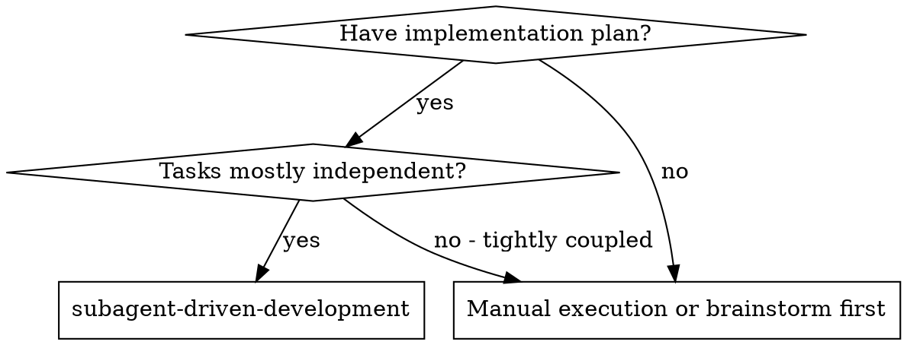
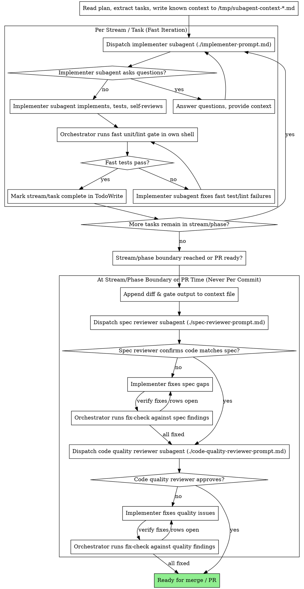

# Subagent-Driven Development

Execute plan by dispatching fresh subagents per cohesive stream. Per-stream/task verification runs the implementer's fast unit tests plus the orchestrator's fast unit/lint gate; read-only `pro` reviewers (`spec-reviewer` then `code-quality-reviewer`, or `comprehensive-code-review`) run once per stream/phase boundary or at PR time against `/tmp/subagent-context-<project>-<stream>.md` (never per commit).

**Core principle:** Fresh subagent per stream + fast unit verification + read-only review at stream/phase boundaries = high quality, fast iteration without token exhaustion

## Execution Roles & Dual-Harness Dispatch

| Role | Claude Code (Anthropic 2026) | Antigravity (Google 2026) | Purpose & Constraints |
|---|---|---|---|
| **Lead Orchestrator** | Opus 5.5 (`model: "opus"`), Effort: `medium` | Argon (`Model: 'pro'`), Thinking: `low` | Coordinates, runs initial triage (`git grep -n`, ≤3 inline calls) to identify the entry-point `file:line` first, writes verified `file:line` facts and open questions to `/tmp/subagent-context-<project>-<stream>.md` (never putting unverified hypotheses under `## Known Facts`; use `## Hypotheses to Falsify`), verifies fast gates in own shell, deletes temp file after review approval, commits. Implements inline on quick (<5-turn, low-context) single-stream tasks and contained bugfixes; delegates multi-turn/multi-file streams. Never halts prematurely between streams. |
| **Implementer Subagent** | Sonnet 5.5 (`model: "sonnet"`, subagent: `implementer`), Effort: `medium` | Gemini 3.8 Flash (`Model: 'flash'`), Thinking: `medium` | Fresh context per cohesive stream. Reads `/tmp/subagent-context-<project>-<stream>.md` first, performs any remaining trace before coding, reads additional files in 600–800 line chunks (never 30–50 line slices), follows TDD using **fast unit tests only** (never E2E or `pretest` builds), zero comments, returns 4-section handoff. Never use Haiku. |
| **Spec / Safety Reviewer** | Opus 5.5 (`subagent_type: "spec-reviewer"` / `"security-reviewer"`), Effort: `high` | Argon (`Model: 'pro'`), Thinking: `high` | **Strictly read-only.** Runs at stream/phase boundary or PR time (never per commit). Reads `/tmp/subagent-context-<project>-<stream>.md` (which includes the `git diff` and orchestrator's passing fast-test output). Never executes tests, builds, or E2E suites. |
| **Code Quality Reviewer** | Opus 5.5 (`subagent_type: "code-quality-reviewer"`), Effort: `high` | Argon (`Model: 'pro'`), Thinking: `high` | **Strictly read-only.** Runs at stream/phase boundary or PR time (never per commit). Adversarial quality, architecture, defensive patterns, and test depth against `/tmp/subagent-context-<project>-<stream>.md`. Never executes tests, builds, or E2E suites. |

### Ephemeral Shared Context File (`/tmp/subagent-context-<project>-<stream>.md`) & Fast-Test Rules

To eliminate duplicate file reads, redundant searches, and $O(N^2)$ token re-billing across subagents:
1. **Save Orchestrator Context to a Temp Flat File:** After running initial triage (`git grep -n`, ≤3 inline calls) to identify the entry-point `file:line`, the orchestrator writes verified `file:line` facts, contract signatures, task goals, and open questions to `/tmp/subagent-context-<project>-<stream>.md` (never putting unverified hypotheses under `## Known Facts`; use `## Hypotheses to Falsify`). If remaining call-site or source tracing across ≥3 files is needed, the implementer subagent performs that trace first and updates `/tmp/subagent-context-<project>-<stream>.md`.
2. **Subagents Read the Temp File First:** Instruct every subagent in the stream to read `/tmp/subagent-context-<project>-<stream>.md` on its first tool call (`view_file` / `Read` up to 800 lines) and **never** re-search or re-read unchanged files already covered in that file. When reading any other file, subagents must read **600–800 lines per call** (never 30–50 line micro-slices).
3. **Fast Local Tests Only (No Local E2E, No `pretest` Builds):**
   - Implementers and orchestrators run **only fast unit tests and typecheck/lint** (`npx vitest run <spec>`, `npm run typecheck`, `go test ./pkg/...`, `bundle exec rspec <spec>`). Never run `pretest` multi-bundle builds on unit test runs.
   - **Never run E2E suites (`playwright test`, `npm run e2e`) or full-repo sweeps locally between fixes, changes, or streams.** While E2E and full-repo sweeps are never run as per-turn iteration gates, before opening or merging a PR the agent must check `.github/workflows/` PR triggers (`pull_request`); if a suite (`e2e`, `govulncheck`, `models`) is gated off on PRs (`if: github.event_name != 'pull_request'`), run the targeted check locally or update/trigger the workflow before merging to `main`.
4. **Append Diff & Gate Output for Read-Only Reviewers:** Per-stream/task verification runs the implementer's fast unit tests plus the orchestrator's fast unit/lint gate in its own shell. Read-only `pro` reviewers (`spec-reviewer`, `code-quality-reviewer`, or `comprehensive-code-review`) run once per stream/phase boundary or at PR time against `/tmp/subagent-context-<project>-<stream>.md` (never per commit). The orchestrator appends the `git diff` and passing gate output to `/tmp/subagent-context-<project>-<stream>.md` and dispatches the read-only reviewers to inspect that file. Reviewers **never** run tests, builds, or E2E suites.
5. **Targeted Single-Reviewer Re-Verification & Cleanup:** If one reviewer returns `APPROVED` and the other requests localized changes, verify the fix with `fix-check` (findings list + fix diff + gate output), never a fresh reviewer. Once the stream is `APPROVED`, **delete the temp file** (`rm -f /tmp/subagent-context-<project>-<stream>.md`).

### Dispatch Syntax

**Claude Code:**
```typescript
Agent({
  subagent_type: "implementer",
  model: "sonnet",
  prompt: "Read /tmp/subagent-context-<project>-<stream>.md first..."
})
```

**Antigravity:**
```typescript
invoke_subagent({
  Subagents: [{
    TypeName: "self",
    Role: "Task Implementer",
    Model: "flash",
    Prompt: "Read /tmp/subagent-context-<project>-<stream>.md first..."
  }]
})
```

**PRECONDITION — the plan must contain an Impact Analysis.** The per-task spec and quality reviews below review *code against the plan*, so a wrong plan propagates into every task dispatched from it. Read the plan before dispatching the first implementer, and raise anything that looks wrong with your human partner rather than building on it.

## When to Use



## The Process



## Prompt Templates

- `./implementer-prompt.md` - Dispatch implementer subagent
- `./spec-reviewer-prompt.md` - Dispatch spec compliance reviewer subagent
- `./code-quality-reviewer-prompt.md` - Dispatch code quality reviewer subagent

## Example Workflow

```
You: I'm using Subagent-Driven Development to execute this plan.

[Read plan file once: docs/plans/feature-plan.md]
[Extract all 5 tasks with full text and context]
[Create TodoWrite with all tasks]

Task 1: Hook installation script

[Get Task 1 text and context (already extracted)]
[Dispatch implementation subagent with full task text + context]

Implementer: "Before I begin - should the hook be installed at user or system level?"

You: "User level (~/.config/superpowers/hooks/)"

Implementer: "Got it. Implementing now..."
[Later] Implementer:
  - Implemented install-hook command
  - Added fast unit tests, 5/5 passing
  - Self-review: Found I missed --force flag, added it
  - Returned 4-section handoff

[Orchestrator runs fast unit/lint gate in own shell: passes]
[Mark Task 1 complete]

Task 2: Recovery modes

[Update /tmp/subagent-context-project-stream.md and dispatch implementation subagent]
Implementer: [No questions, proceeds]
Implementer:
  - Added verify/repair modes
  - 8/8 fast unit tests passing
  - Returned 4-section handoff

[Orchestrator runs fast unit/lint gate in own shell: passes]
[Mark Task 2 complete]

...

[Stream/phase boundary reached or PR ready — append git diff & fast gate output to /tmp/subagent-context-project-stream.md]
[Dispatch read-only spec reviewer]
Spec reviewer: ❌ Issues:
  - Missing: Progress reporting (spec says "report every 100 items")
  - Extra: Added --json flag (not requested)

[Implementer fixes issues]
Implementer: Removed --json flag, added progress reporting

[Orchestrator runs fix-check on the two spec findings: both FIXED]
fix-check: 2 of 2 FIXED, no unrequested changes

[Dispatch read-only code quality reviewer]
Code reviewer: Strengths: Solid. Issues (Important): Magic number (100)

[Implementer fixes]
Implementer: Extracted PROGRESS_INTERVAL constant

[Orchestrator runs fix-check on the quality finding: FIXED]
fix-check: ready to merge

[Delete /tmp/subagent-context-project-stream.md]
Done!
```

## Advantages

**vs. Manual execution:**

- Subagents follow TDD naturally
- Fresh context per stream/task (no confusion)
- Parallel-safe on disjoint files (subagents don't interfere)
- Subagent can ask questions (before AND during work)

**Efficiency gains:**

- Shared `/tmp/subagent-context-<project>-<stream>.md` eliminates duplicate file reads and searches
- Controller curates verified `file:line` context upfront after initial triage
- Subagent gets complete information upfront
- Questions surfaced before work begins (not after)

**Quality gates:**

- Self-review + orchestrator fast unit/lint gate catches issues per stream
- Two-stage read-only review (`spec-reviewer` then `code-quality-reviewer`, or `comprehensive-code-review`) runs once at stream/phase boundary or PR time (never per commit)
- fix-check confirms each fix against its finding without a new review
- Spec compliance prevents over/under-building
- Code quality ensures implementation is well-built

**Cost:**

- Reviewers run only at stream/phase boundaries or PR time (never per commit)
- Controller does initial triage (`git grep -n`, ≤3 calls) and writes verified context to `/tmp/subagent-context-<project>-<stream>.md`
- Catches issues without per-task review loops

## Red Flags

**Never:**

- Skip reviews (spec compliance OR code quality)
- Proceed with unfixed issues
- Dispatch multiple implementation subagents against overlapping files in parallel (independent streams touching disjoint files MAY and SHOULD be dispatched in parallel per GEMINI.md Phase 4)
- Make subagent read plan file (provide full text instead)
- Skip scene-setting context (subagent needs to understand where task fits)
- Ignore subagent questions (answer before letting them proceed)
- Accept "close enough" on spec compliance (spec reviewer found issues = not done)
- Skip the fix-check after a fix round (reviewer found issues = implementer fixes = fix-check those findings)
- Let implementer self-review replace actual review (both are needed)
- **Start code quality review before spec compliance is ✅** (wrong order)
- Move to next task while either review has open issues

**If subagent asks questions:**

- Answer clearly and completely
- Provide additional context if needed
- Don't rush them into implementation

**If reviewer finds issues:**

- Implementer (same subagent) fixes them
- The orchestrator runs `fix-check` on the fix diff against those findings. No fresh review
- Send back only the rows fix-check marks NOT FIXED or PARTIAL; repeat fix-check on the next fix
- Don't dispatch a new comprehensive review after a fix round: it re-reads everything, finds new MINORs and the loop never closes

**If subagent fails task:**

- Dispatch fix subagent with specific instructions
- Don't try to fix manually (context pollution)

## Integration

**Required workflow skills:**

- **superpowers:writing-plans** - Creates the plan this skill executes
- **superpowers:requesting-code-review** - Code review template for reviewer subagents
- **superpowers:finishing-a-development-branch** - Complete development after all tasks

**Subagents should use:**

- **superpowers:test-driven-development** - Subagents follow TDD for each task
