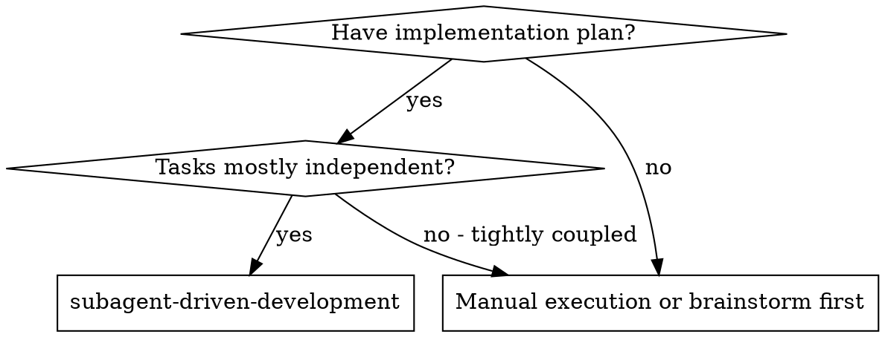
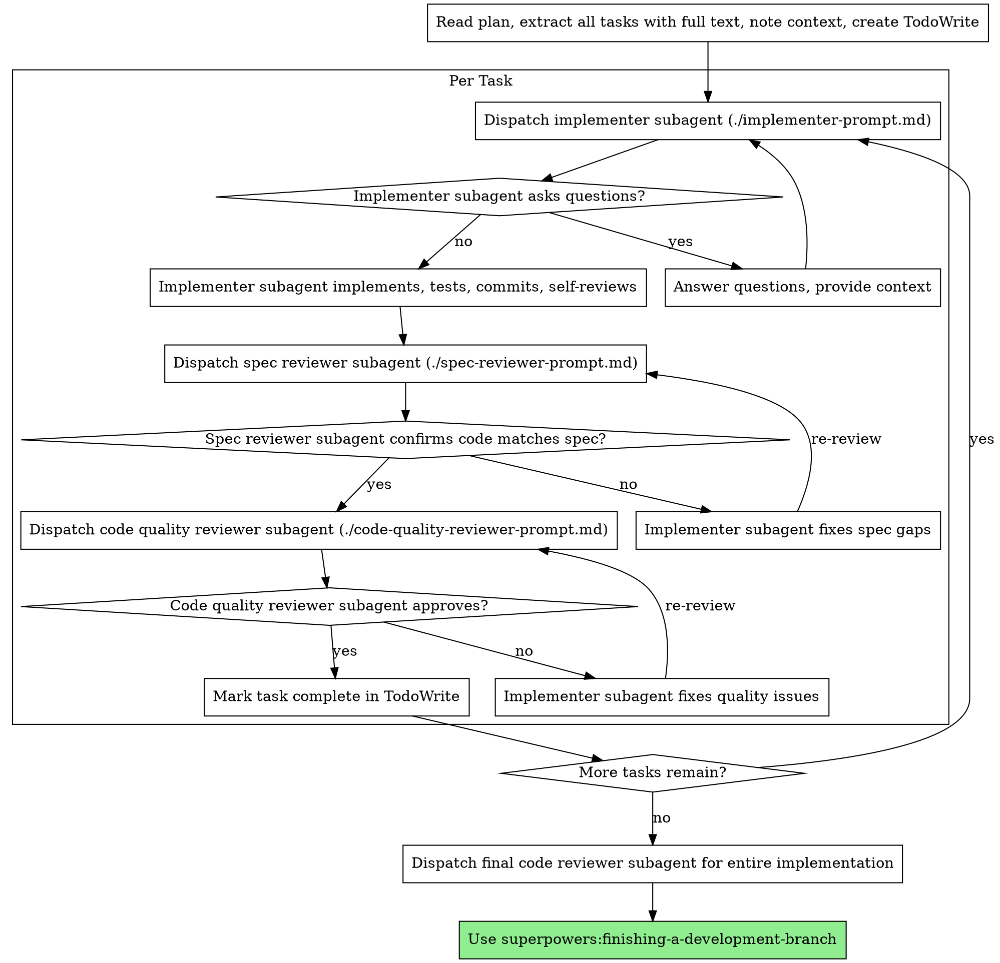

# Subagent-Driven Development

Execute plan by dispatching fresh subagent per task, with two-stage review after each: spec compliance review first, then code quality review.

**Core principle:** Fresh subagent per task + two-stage review (spec then quality) = high quality, fast iteration

## Execution Roles & Dual-Harness Dispatch

| Role | Claude Code (Anthropic 2026) | Antigravity (Google 2026) | Purpose & Constraints |
|---|---|---|---|
| **Lead Orchestrator** | Opus 5.5 (`model: "opus"`), Effort: `medium` | Argon (`Model: 'pro'`), Thinking: `low` | Coordinates, traces, writes discovered context to `/tmp/subagent-context-<project>-<stream>.md`, verifies fast gates in own shell, deletes temp file after review approval, commits. Never writes implementation code inline. Never halts prematurely between streams. |
| **Implementer Subagent** | Sonnet 5.5 (`model: "sonnet"`, subagent: `implementer`), Effort: `medium` | Gemini 3.8 Flash (`Model: 'flash'`), Thinking: `medium` | Fresh context per cohesive stream. Reads `/tmp/subagent-context-<project>-<stream>.md` first, reads additional files in 600–800 line chunks (never 30–50 line slices), follows TDD using **fast unit tests only** (never E2E or `pretest` builds), zero comments, returns 4-section handoff. Never use Haiku. |
| **Spec / Safety Reviewer** | Opus 5.5 (`subagent_type: "spec-reviewer"` / `"security-reviewer"`), Effort: `high` | Argon (`Model: 'pro'`), Thinking: `high` | **Strictly read-only.** Reads `/tmp/subagent-context-<project>-<stream>.md` (which includes the `git diff` and orchestrator's passing fast-test output). Never executes tests, builds, or E2E suites. |
| **Code Quality Reviewer** | Opus 5.5 (`subagent_type: "code-quality-reviewer"`), Effort: `high` | Argon (`Model: 'pro'`), Thinking: `high` | **Strictly read-only.** Adversarial quality, architecture, defensive patterns, and test depth against `/tmp/subagent-context-<project>-<stream>.md`. Never executes tests, builds, or E2E suites. |

### Ephemeral Shared Context File (`/tmp/subagent-context-<project>-<stream>.md`) & Fast-Test Rules

To eliminate duplicate file reads, redundant searches, and $O(N^2)$ token re-billing across subagents:
1. **Save Orchestrator Context to a Temp Flat File:** Before dispatching the implementer for a stream, the orchestrator writes all relevant pre-traced data (exact target file snippets with line numbers, interfaces/contracts, call sites, and task requirements) to `/tmp/subagent-context-<project>-<stream>.md`.
2. **Subagents Read the Temp File First:** Instruct every subagent in the stream to read `/tmp/subagent-context-<project>-<stream>.md` on its first tool call (`view_file` / `Read` up to 800 lines) and **never** re-search or re-read unchanged files already covered in that file. When reading any other file, subagents must read **600–800 lines per call** (never 30–50 line micro-slices).
3. **Fast Local Tests Only (No Local E2E, No `pretest` Builds):**
   - Implementers and orchestrators run **only fast unit tests and typecheck/lint** (`npx vitest run <spec>`, `npm run typecheck`, `go test ./pkg/...`, `bundle exec rspec <spec>`). Never run `pretest` multi-bundle builds on unit test runs.
   - **Never run E2E suites (`playwright test`, `npm run e2e`) locally between fixes, changes, or streams.** E2E runs strictly in **nightly scheduled CI** and **deployment pipelines** (Dokploy).
4. **Append Diff & Gate Output for Read-Only Reviewers:** After the implementer finishes, the orchestrator runs the fast unit/lint gate in its own shell, appends the `git diff` and passing gate output to `/tmp/subagent-context-<project>-<stream>.md`, and dispatches the parallel read-only reviewers (`code-quality-reviewer` + `security-reviewer`) to read that file. Reviewers **never** run tests, builds, or E2E suites.
5. **Targeted Single-Reviewer Re-Verification & Cleanup:** If one reviewer returns `APPROVED` and the other requests localized changes, re-dispatch **only the reviewer that requested changes** after the fix is verified and appended to the temp file. Once the stream is `APPROVED`, **delete the temp file** (`rm -f /tmp/subagent-context-<project>-<stream>.md`).

### Dispatch Syntax

**Claude Code:**
```typescript
Agent({
  subagent_type: "implementer",
  model: "sonnet",
  prompt: "Read /tmp/subagent-context-<project>-<stream>.md first..."
})
```

**Antigravity:**
```typescript
invoke_subagent({
  Subagents: [{
    TypeName: "self",
    Role: "Task Implementer",
    Model: "flash",
    Prompt: "Read /tmp/subagent-context-<project>-<stream>.md first..."
  }]
})
```

**PRECONDITION — the plan must contain an Impact Analysis.** The per-task spec and quality reviews below review *code against the plan*, so a wrong plan propagates into every task dispatched from it. Read the plan before dispatching the first implementer, and raise anything that looks wrong with your human partner rather than building on it.

## When to Use



## The Process



## Prompt Templates

- `./implementer-prompt.md` - Dispatch implementer subagent
- `./spec-reviewer-prompt.md` - Dispatch spec compliance reviewer subagent
- `./code-quality-reviewer-prompt.md` - Dispatch code quality reviewer subagent

## Example Workflow

```
You: I'm using Subagent-Driven Development to execute this plan.

[Read plan file once: docs/plans/feature-plan.md]
[Extract all 5 tasks with full text and context]
[Create TodoWrite with all tasks]

Task 1: Hook installation script

[Get Task 1 text and context (already extracted)]
[Dispatch implementation subagent with full task text + context]

Implementer: "Before I begin - should the hook be installed at user or system level?"

You: "User level (~/.config/superpowers/hooks/)"

Implementer: "Got it. Implementing now..."
[Later] Implementer:
  - Implemented install-hook command
  - Added tests, 5/5 passing
  - Self-review: Found I missed --force flag, added it
  - Committed

[Dispatch spec compliance reviewer]
Spec reviewer: ✅ Spec compliant - all requirements met, nothing extra

[Get git SHAs, dispatch code quality reviewer]
Code reviewer: Strengths: Good test coverage, clean. Issues: None. Approved.

[Mark Task 1 complete]

Task 2: Recovery modes

[Get Task 2 text and context (already extracted)]
[Dispatch implementation subagent with full task text + context]

Implementer: [No questions, proceeds]
Implementer:
  - Added verify/repair modes
  - 8/8 tests passing
  - Self-review: All good
  - Committed

[Dispatch spec compliance reviewer]
Spec reviewer: ❌ Issues:
  - Missing: Progress reporting (spec says "report every 100 items")
  - Extra: Added --json flag (not requested)

[Implementer fixes issues]
Implementer: Removed --json flag, added progress reporting

[Spec reviewer reviews again]
Spec reviewer: ✅ Spec compliant now

[Dispatch code quality reviewer]
Code reviewer: Strengths: Solid. Issues (Important): Magic number (100)

[Implementer fixes]
Implementer: Extracted PROGRESS_INTERVAL constant

[Code reviewer reviews again]
Code reviewer: ✅ Approved

[Mark Task 2 complete]

...

[After all tasks]
[Dispatch final code-reviewer]
Final reviewer: All requirements met, ready to merge

Done!
```

## Advantages

**vs. Manual execution:**

- Subagents follow TDD naturally
- Fresh context per task (no confusion)
- Parallel-safe (subagents don't interfere)
- Subagent can ask questions (before AND during work)

**Efficiency gains:**

- No file reading overhead (controller provides full text)
- Controller curates exactly what context is needed
- Subagent gets complete information upfront
- Questions surfaced before work begins (not after)

**Quality gates:**

- Self-review catches issues before handoff
- Two-stage review: spec compliance, then code quality
- Review loops ensure fixes actually work
- Spec compliance prevents over/under-building
- Code quality ensures implementation is well-built

**Cost:**

- More subagent invocations (implementer + 2 reviewers per task)
- Controller does more prep work (extracting all tasks upfront)
- Review loops add iterations
- But catches issues early (cheaper than debugging later)

## Red Flags

**Never:**

- Skip reviews (spec compliance OR code quality)
- Proceed with unfixed issues
- Dispatch multiple implementation subagents in parallel (conflicts)
- Make subagent read plan file (provide full text instead)
- Skip scene-setting context (subagent needs to understand where task fits)
- Ignore subagent questions (answer before letting them proceed)
- Accept "close enough" on spec compliance (spec reviewer found issues = not done)
- Skip review loops (reviewer found issues = implementer fixes = review again)
- Let implementer self-review replace actual review (both are needed)
- **Start code quality review before spec compliance is ✅** (wrong order)
- Move to next task while either review has open issues

**If subagent asks questions:**

- Answer clearly and completely
- Provide additional context if needed
- Don't rush them into implementation

**If reviewer finds issues:**

- Implementer (same subagent) fixes them
- Reviewer reviews again
- Repeat until approved
- Don't skip the re-review

**If subagent fails task:**

- Dispatch fix subagent with specific instructions
- Don't try to fix manually (context pollution)

## Integration

**Required workflow skills:**

- **superpowers:writing-plans** - Creates the plan this skill executes
- **superpowers:requesting-code-review** - Code review template for reviewer subagents
- **superpowers:finishing-a-development-branch** - Complete development after all tasks

**Subagents should use:**

- **superpowers:test-driven-development** - Subagents follow TDD for each task
